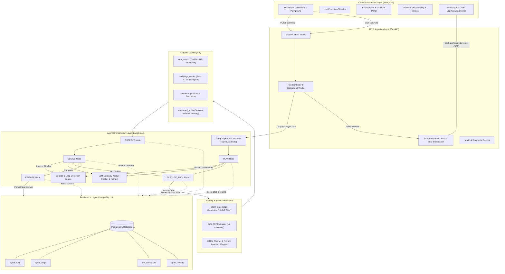
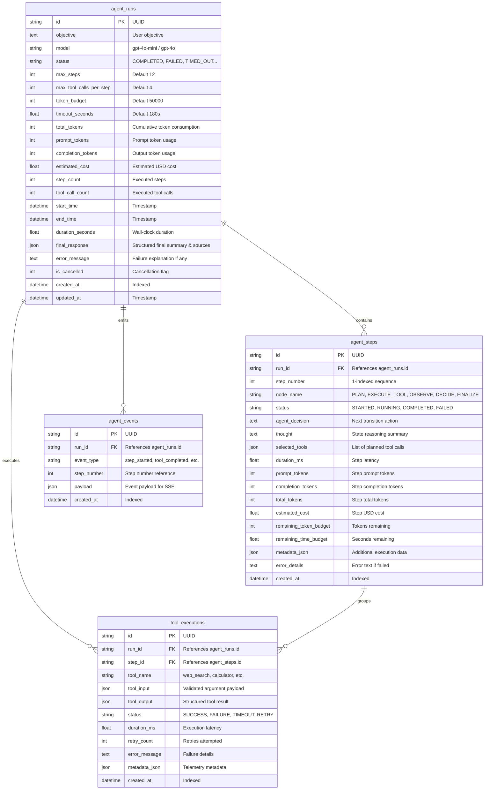

# Comprehensive Architecture Specification

## 1. System Topology & Component Interactions

---

## 2. LangGraph State Machine Lifecycle

```mermaid
stateDiagram-v2
    [*] --> START
    START --> PLAN: Initialize run state & bounds
    
    state PLAN {
        [*] --> EvaluateObjective
        EvaluateObjective --> CheckBounds1: Step/Token/Timeout check
        CheckBounds1 --> FormulateSubGoals: Bounds OK
        CheckBounds1 --> BranchToFinalize1: Bounds Exceeded
        FormulateSubGoals --> SelectInitialTools
        SelectInitialTools --> [*]
    }

    PLAN --> EXECUTE_TOOL: Valid initial action
    PLAN --> FINALIZE: Limit triggered early

    state EXECUTE_TOOL {
        [*] --> ValidateArgsSchema
        ValidateArgsSchema --> CheckSSRF_AST
        CheckSSRF_AST --> DispatchAsyncTools: Max 4 tool calls
        DispatchAsyncTools --> RetryWithJitter: On transient network error
        RetryWithJitter --> RecordToolAudit
        RecordToolAudit --> UpdateActionHistory: Track signature for loop detection
        UpdateActionHistory --> [*]
    }

    EXECUTE_TOOL --> OBSERVE: Tool results ready
    EXECUTE_TOOL --> FINALIZE: Critical execution fault

    state OBSERVE {
        [*] --> ExtractRawData
        ExtractRawData --> SanitizeOutput
        SanitizeOutput --> DistillObservations
        DistillObservations --> UpdateRemainingBudgets
        UpdateRemainingBudgets --> [*]
    }

    OBSERVE --> DECIDE: Observations distilled

    state DECIDE {
        [*] --> CheckSafetyBounds: Max 12 steps / Budget / 3x Loop check
        CheckSafetyBounds --> RouteFinalize: Goal met OR limits reached
        CheckSafetyBounds --> CheckActionRepetition: Goal incomplete
        CheckActionRepetition --> FilterDuplicates
        FilterDuplicates --> SelectNextTools: Propose novel actions
        SelectNextTools --> [*]
    }

    DECIDE --> EXECUTE_TOOL: Next tools selected (Loop)
    DECIDE --> FINALIZE: Research completed or bounds reached

    state FINALIZE {
        [*] --> AggregateObservationsAndNotes
        AggregateObservationsAndNotes --> SynthesizeFinalAnswer
        SynthesizeFinalAnswer --> ExtractKeyFindings
        ExtractKeyFindings --> CompileSourceCitations
        CompileSourceCitations --> PersistRunStatus
        PersistRunStatus --> [*]
    }

    FINALIZE --> END
    END --> [*]
```

---

## 3. End-to-End Sequence Diagram

```mermaid
sequenceDiagram
    autonumber
    actor User as User / Browser
    participant API as FastAPI Backend
    participant DB as PostgreSQL
    participant EBus as EventBus (SSE)
    participant Graph as LangGraph Engine
    participant Security as Security Gate
    participant Tools as Tool Registry
    participant LLM as OpenAI Gateway

    User->>API: POST /api/runs (objective, model, bounds)
    API->>DB: INSERT INTO agent_runs (status=PENDING)
    API->>API: Dispatch background asyncio task
    API-->>User: HTTP 201 Created (RunSummary)

    User->>API: GET /api/runs/{id}/events
    API->>EBus: Subscribe queue for run_id
    API-->>User: SSE Stream Connected (run_state)

    API->>Graph: Execute workflow(initial_state)
    Graph->>DB: UPDATE agent_runs (status=RUNNING)
    EBus-->>User: event: run_started

    rect rgb(25, 30, 45)
        Note over Graph,LLM: Step 1: PLAN Node
        Graph->>DB: INSERT INTO agent_steps (step 1, node=PLAN)
        EBus-->>User: event: step_started (PLAN)
        Graph->>LLM: Formulate structured research plan
        LLM-->>Graph: Plan + Planned steps + Initial tool
        Graph->>DB: UPDATE agent_steps (COMPLETED, thought, tokens, cost)
        EBus-->>User: event: step_completed
    end

    rect rgb(35, 30, 25)
        Note over Graph,Tools: Step 2: EXECUTE_TOOL Node
        Graph->>DB: INSERT INTO agent_steps (step 2, node=EXECUTE_TOOL)
        EBus-->>User: event: step_started (EXECUTE_TOOL)
        Graph->>Security: Validate target URL / AST math expression
        Security-->>Graph: Security clearance OK
        Graph->>Tools: Invoke web_search(query)
        Tools-->>Graph: Search results (URLs + Snippets)
        Graph->>DB: INSERT INTO tool_executions (tool_name, input, output, duration_ms)
        EBus-->>User: event: tool_completed
        Graph->>DB: UPDATE agent_steps (COMPLETED, duration_ms)
    end

    rect rgb(25, 35, 35)
        Note over Graph,DB: Step 3: OBSERVE Node
        Graph->>DB: INSERT INTO agent_steps (step 3, node=OBSERVE)
        EBus-->>User: event: step_started (OBSERVE)
        Graph->>Graph: Sanitize tool outputs & summarize findings
        Graph->>DB: UPDATE agent_steps (COMPLETED, observations)
    end

    rect rgb(35, 25, 45)
        Note over Graph,LLM: Step 4: DECIDE Node
        Graph->>DB: INSERT INTO agent_steps (step 4, node=DECIDE)
        EBus-->>User: event: step_started (DECIDE)
        Graph->>Graph: Check bounds (Step < 12, Budget OK, No loops)
        Graph->>LLM: Evaluate evidence sufficiency
        LLM-->>Graph: Decision: FINALIZE
        Graph->>DB: UPDATE agent_steps (COMPLETED, decision=FINALIZE)
    end

    rect rgb(25, 45, 30)
        Note over Graph,DB: Step 5: FINALIZE Node
        Graph->>DB: INSERT INTO agent_steps (step 5, node=FINALIZE)
        Graph->>LLM: Synthesize final answer, key findings & sources
        LLM-->>Graph: Structured final payload
        Graph->>DB: UPDATE agent_runs (status=COMPLETED, final_response, duration, total_cost)
        Graph->>DB: UPDATE agent_steps (COMPLETED)
        EBus-->>User: event: run_completed (final_response)
    end

    User->>User: Render FinalAnswerPanel & complete timeline
```

---

## 4. Database Entity-Relationship Diagram (ERD)

